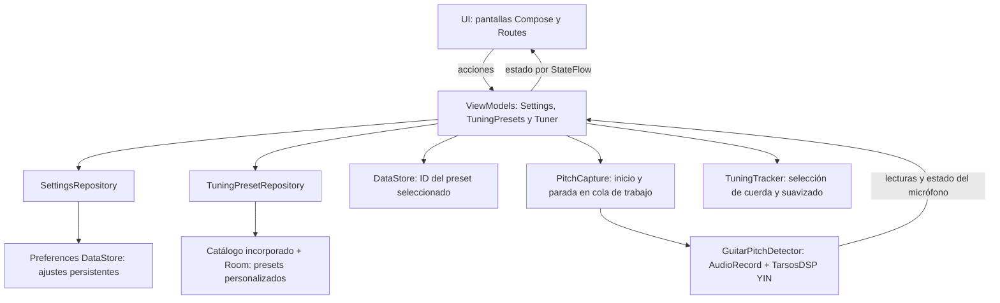

#  Eztunez

Afinador de guitarra nativo para Android, offline, sin anuncios y con soporte
para distintas afinaciones.

## El problema

Los músicos principiantes e intermedios necesitan afinar su instrumento de
forma rápida y confiable antes de tocar, pero muchos afinadores disponibles
hoy tienen anuncios invasivos, detección de tono poco precisa, o dependen de
internet para algo que debería funcionar 100% offline.

## Propuesta de valor

Una app simple que escucha la cuerda a través del micrófono del teléfono,
detecta la nota más cercana y le dice al usuario si tiene que tensar o
destensar la cuerda — sin conexión a internet, sin pagos y sin publicidad
que interrumpa el proceso de afinación.

## Usuarios objetivo

Estudiantes de guitarra, músicos principiantes, guitarristas aficionados y
profesores de música que necesitan una herramienta rápida durante ensayos o
presentaciones.

## Plataforma y stack técnico

| | |
|---|---|
| Sistema operativo | Android (minSdk 28, compileSdk 36) |
| Lenguaje | Kotlin |
| UI | Jetpack Compose |
| Detección | AudioRecord + TarsosDSP YIN |
| Preferencias | Preferences DataStore |
| Presets personalizados | Room 2.7.2 + KSP 2.0.21-1.0.28 (KSP2) |

## Cómo correr el proyecto

1. Abrir la carpeta del proyecto en Android Studio.
2. Dejar que Gradle sincronice.
3. Conectar un dispositivo físico o levantar un emulador (API 28 o superior).
4. Correr la app ( Run 'app').

Desde terminal, con `JAVA_HOME` apuntando al JBR/JDK compatible:

```bash
./gradlew testDebugUnitTest
./gradlew assembleDebug
```

## Estado actual del proyecto

- [x] Captura real del micrófono con `AudioRecord`
- [x] Detección de pitch con TarsosDSP/YIN
- [x] Auto Tune y Manual Tune para E2, A2, D3, G3, B3 y E4
- [x] Aguja, cents y mensajes Tune Up / Tune Down / In Tune
- [x] Ajustes persistentes de sensibilidad, A4, Hz, notación y tema
- [x] Estados básicos de permiso, inicialización e interrupción del micrófono
- [x] Presets Standard, Drop D, Open G, DADGAD y Half Step Down conectados al motor
- [x] Crear, editar y eliminar presets personalizados almacenados en Room
- [x] Selección del preset conservada entre aperturas mediante DataStore
- [ ] FFT avanzada (no disponible; la interfaz la muestra deshabilitada)

## Verificación manual de la fase Manual Tune + Settings

En un teléfono físico con una fuente de sonido adecuada:

1. Conceder el permiso de micrófono y comprobar Auto Tune en las seis cuerdas.
2. Abrir Manual Tune, seleccionar cada objetivo y verificar que no cambie automáticamente.
3. Cambiar de cuerda y confirmar que se borren la lectura y la aguja anteriores.
4. Probar notas bajas/altas y confirmar Tune Up, Tune Down e In Tune.
5. Cambiar sensibilidad y A4; volver al afinador y comprobar su efecto.
6. Ocultar Hz, cambiar entre Standard/Solfège y alternar el tema.
7. Cerrar por completo y reabrir la app para confirmar la persistencia.
8. Denegar el permiso, reintentar y probar el acceso a ajustes cuando quede bloqueado.

La compilación automatizada no sustituye esta verificación acústica en hardware real.

## Arquitectura

La app sigue MVVM: la UI envía acciones a los ViewModels y observa su estado
mediante `StateFlow`. Los ajustes y presets usan repositorios; el afinador usa
una interfaz de captura de audio y un tracker para procesar las lecturas.



`MainActivity` crea y conecta estas dependencias. Las Routes gestionan la conexión
con Android; `TunerRoute` controla permisos y el ciclo de vida del micrófono.

- `MainActivity` crea los ViewModels con factories e inyección manual. La captura
  utiliza el contexto de aplicación; el ViewModel no conserva una Activity.
- `TunerRoute` conecta permisos, ajustes de Android y duración de la pantalla con
  `TunerViewModel`. `TuneScreen` recibe estado de solo lectura y callbacks.
- `TunerViewModel` coordina `TuningTracker` y la interfaz `PitchCapture` mediante
  `StateFlow`. `GuitarPitchDetector` implementa la captura; YIN y sus umbrales no
  cambian. Los callbacks de capturas anteriores se descartan al detener o reintentar.
- `QueuedPitchCaptureFactory` ejecuta la creación, inicio y parada del driver en
  una cola de trabajo compartida. La UI solicita la parada y limpia su lectura sin
  esperar operaciones nativas ni `join`. La siguiente captura espera a que termine
  la limpieza anterior, incluso si el ViewModel ya fue eliminado. El hilo lector
  libera su `AudioRecord` en `finally`, también si falla la recuperación.
- `TuningPresetsRoute` conecta la pantalla con `TuningPresetsViewModel`; el catálogo
  local vive en `TuningPresetRepository`. Cada preset define seis notas MIDI con
  octavas. La selección compartida configura Home, Tune, el tracker y las referencias
  del analizador. Los objetivos se recalculan según el A4 elegido en Settings.
- `SettingsRoute` conecta `SettingsScreen` con el ViewModel y el repositorio
  DataStore existentes. Home conserva únicamente estado visual local.

La pantalla actual y el modo de afinación usan `rememberSaveable`. Al rotar, los
ViewModels conservan el objetivo manual y los filtros/selección de presets; el
registro anterior del micrófono se detiene y la nueva pantalla inicia otra captura.
La sesión del afinador se reinicia al navegar a otra pantalla, conservando el preset
activo. Salir de Presets reinicia solo su filtro. El ID seleccionado se guarda en
DataStore. Al abrir la app se espera tanto a los presets de Room como a esa
preferencia antes de restaurar la selección. Si el preset ya no existe, se usa
Standard y se guarda esa selección. No se guardan muestras de audio en el estado de Android.

El indicador de carga aparece únicamente mientras llega la primera lectura de
DataStore, sin temporizador ni calibración de micrófono simulada. Los ajustes ya
cargados se conservan durante la recreación. La captura solo se inicia con permiso
y con el afinador en estado `RESUMED`. Al pausar, bloquear o dejar la aplicación se
solicita liberar el micrófono en segundo plano; al volver se comprueba el permiso y se inicia una nueva captura
con el mismo objetivo. Los reintentos usan la misma condición de ciclo de vida.
Al detenerse la captura o recibir un error de micrófono se borran inmediatamente
la medición, los cents y el historial de suavizado, conservando la cuerda elegida.
Un callback tardío no puede restablecer una lectura de una captura detenida. Las
pausas breves de señal durante una captura activa mantienen su tolerancia habitual.
La restauración de selecciones de los ViewModels
después de que Android termine el proceso también queda pendiente.

Los ajustes se aplican inmediatamente en memoria. La sensibilidad se guarda al
terminar el gesto (también al salir o pasar a segundo plano si se interrumpe).
Los cambios pendientes se agrupan y guardan en orden mediante una edición atómica
de DataStore, omitiendo valores sin cambios. Si falla una escritura, Settings
muestra un error persistente con reintento; las opciones siguen activas en la sesión.

Los textos visibles, mensajes de micrófono, etiquetas accesibles y descripciones de
presets integrados se definen en `app/src/main/res/values/strings.xml`. Los valores
variables usan marcadores indexados; los presets personalizados mantienen su texto.
La notación musical y las claves persistidas no se traducen.

Home y Tune usan contenido desplazable con ancho máximo centrado. Sus encabezados,
tarjetas y controles crecen con el texto; las cuerdas se distribuyen en varias filas
cuando no caben y el medidor respeta tanto su ancho como su altura.
La navegación compartida muestra solo iconos si las etiquetas no caben con el
tamaño de texto elegido, conservando sus nombres accesibles. Las pruebas
`ResponsiveScreensTest` comprueban ventanas de 800×360 y 280×360 dp, además de
320×480 dp con texto al 200 %, sin modificar la configuración del teléfono.

Las pruebas de ViewModels usan una captura falsa y un reloj controlado para
verificar selección manual/automática, cambios de sensibilidad y A4, reintentos,
callbacks tardíos, liberación de recursos y filtros de presets. Ejecutar:

```bash
./gradlew testDebugUnitTest assembleDebug lintDebug
```

`AppStateRestorationTest` verifica el destino, modo manual, objetivo, presets y
reemplazo de captura al recrear la composición con estado guardado. Usa un
micrófono falso; requiere dispositivo o emulador para ejecutarse:

```bash
./gradlew connectedDebugAndroidTest
```

## Presets personalizados

En Presets, **Create Custom** abre un formulario que comienza con Standard:
E2, A2, D3, G3, B3 y E4. Las etiquetas van de la cuerda 6 (grave y gruesa) a la
cuerda 1 (aguda y delgada). Cada cuerda tiene selectores de nota y octava; no se
escriben notas a mano. El nombre es obligatorio y la descripción opcional.

Se quitan espacios sobrantes y se rechazan nombres duplicados sin distinguir
mayúsculas, incluidos los nombres de presets incorporados. Durante el guardado
se deshabilitan las acciones para impedir escrituras duplicadas. Si falla,
el formulario conserva sus datos y permite reintentar.

El nuevo preset aparece en All Presets y Custom. Seleccionarlo configura Home,
Auto Tune y Manual Tune, con frecuencias calculadas desde sus seis valores MIDI
y la referencia A4 de Settings. La ventana de frecuencias se amplía para abarcar
los objetivos personalizados; los presets incorporados conservan su ventana original
de 60–400 Hz. Como con cualquier afinador, los extremos MIDI y las octavas muy graves
requieren comprobar la respuesta acústica del micrófono y del algoritmo YIN. Edit y Delete solo están disponibles para los
personalizados. Delete pide confirmación; borrar el preset seleccionado vuelve
a Standard. Un error al guardar la selección se muestra con una acción Retry.

Room usa una instancia por proceso creada con el contexto de aplicación, DAO
suspendidos y Flow para actualizar la lista. Sus IDs se exponen como negativos,
separados de los positivos del catálogo. Las escrituras se validan en el
repositorio y un índice único protege los nombres normalizados. La base v1
exporta su esquema en `app/schemas`; las futuras versiones deben añadir
migraciones y conservar los esquemas, sin borrado destructivo de datos.

Se conservó Kotlin 2.0.21: [Room 2.7.2 estable](https://developer.android.com/jetpack/androidx/releases/room#2.7.2)
requiere Kotlin 2.0 o superior y se usa con [KSP 2.0.21-1.0.28](https://github.com/google/ksp/releases/tag/2.0.21-1.0.28),
con KSP2 habilitado. La compilación comprueba esta combinación sin actualizar el resto del stack.

Pruebas adicionales:

- `CustomPresetValidationTest`: normalización, valores válidos y referencia A4.
- `CustomPresetsViewModelTest`: carga diferida, restauración, CRUD, confirmación,
  escrituras repetidas, fallos y reintentos.
- `CustomPresetStorageTest`: Room real, unicidad, protección de incorporados y
  persistencia al cerrar/reabrir la base de datos.
- `PresetSelectionStorageTest`: selección y ajustes al reabrir DataStore.
- `CustomPresetUiTest`: formulario, duplicados, Auto/Manual, edición y eliminación.
- `CustomPresetTuningTest`: audio sintetizado de notas graves y agudas, Auto/Manual y A4=432/440.
- `ResponsiveScreensTest`: editor y lista de presets con texto ampliado y ambos temas.

Resultados de esta implementación: 82 pruebas unitarias y 26 pruebas de dispositivo
aprobadas, sin fallos ni omisiones, con `assembleDebug` correcto. Las de dispositivo
incluyen cuatro de restauración, nueve de ciclo de vida del micrófono, seis de
pantallas, tres de Room, dos de CRUD en UI, una de DataStore y la prueba básica de Android.
También se creó y seleccionó un preset temporal en la aplicación real, se terminó
su proceso y se abrió de nuevo: permanecieron tanto el preset como su selección.
Después se eliminó ese preset y se comprobó el regreso a Standard.

El usuario ejecutó manualmente `./gradlew lintDebug --console=plain` y terminó
con `BUILD SUCCESSFUL`. También comprobó manualmente la creación, edición y
eliminación, y que los presets y su selección se conservan al cerrar y reabrir la app.
La respuesta acústica con una guitarra real y los extremos del rango MIDI quedan
para comprobación manual; las pruebas de audio usan señales sintetizadas.

Verificación manual:

1. Crear un preset con nombre propio, descripción y, por ejemplo, D2 en la cuerda 6.
2. Guardar, comprobar All Presets y Custom, y seleccionarlo.
3. Abrir Manual Tune y probar los seis objetivos; abrir Auto Tune y comprobar la detección.
4. Cerrar completamente y reabrir la aplicación: deben seguir el preset y su selección.
5. Editarlo y guardar: deben actualizarse sus objetivos sin crear otro preset.
6. Probar un nombre vacío y otro duplicado con diferentes mayúsculas.
7. Cancelar Delete y comprobar que permanece; confirmar Delete y verificar Standard.
8. Repetir con tema claro/oscuro, texto ampliado, rotación y cambio de A4.

## Equipo

- Brian Bernabe Bolaños Arreaga — 24846
- Dostyn López Bautista — 251404
- Eduardo Isaí López Sutuc — 251832
- Maria A. Flores — 251646

Proyecto para el curso *Panorama del desarrollo móvil 2026*, Universidad del
Valle de Guatemala.
